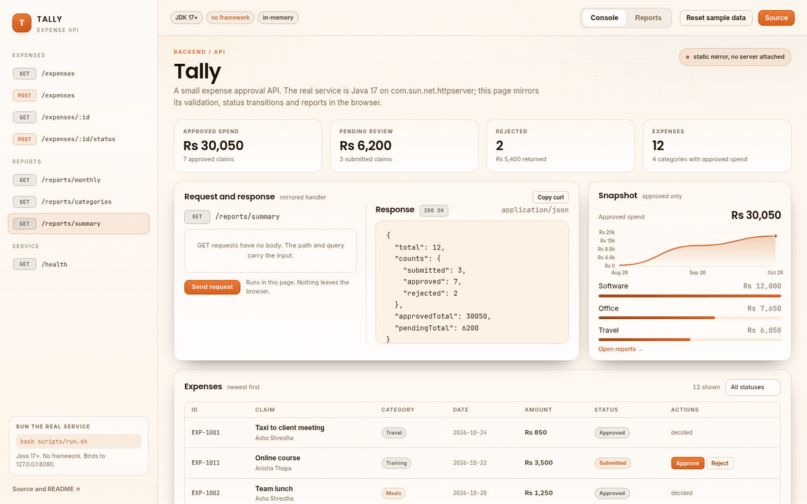

<div align="center">

</div>

<sub>Recorded from the live demo &middot; <a href="docs/demo.mp4">MP4</a> &middot; <a href="docs/screenshot.png">static frame</a></sub>

# Tally

An expense API written against nothing but the JDK. `com.sun.net.httpserver` for
the server, a small hand written JSON mapper, an in-memory repository behind an
interface, and a status machine that owns the rules: an expense can be
submitted, approved, rejected, or reopened, and nothing else. No framework, no
Maven, no dependencies.

[**Live demo**](https://arvion-technology.github.io/labs/demos/tally-api/demo/) &middot; [MIT](LICENSE)

---

## What it does

- `POST /expenses` submits an expense with amount, category, currency and note.
- `GET /expenses` lists with status and category filters and a bounded limit.
- `POST /expenses/{id}/approve` and `/reject` apply the status machine and return
  the new state, or a problem document on an illegal transition.
- `GET /reports/monthly` and `GET /reports/by-category` aggregate approved spend.
- `GET /healthz` reports process health and the request count.

## How it is built

Java 17 source compiled with `javac`, no external libraries. Handlers are small
classes over a shared request guard; validation lives in the domain layer, not in
the HTTP layer. Money is stored in minor units as a long, never as a float.

```
src/main/java/com/arvion/tally/
  api/        ApiServer, handlers, JsonMapper, ApiException
  domain/     Expense, Category, ExpenseStatus, ExpenseService
  store/      ExpenseStore interface, InMemoryExpenseStore
tests/        a custom harness: asserts, HTTP round trips, status machine
scripts/      test.sh (javac + java), run.sh (start the server)
```

The browser demo in `demo/` is a mirror of the same API and status machine in
JavaScript, with a visible note that the production implementation is Java.

## Run it

```bash
bash scripts/test.sh     # compile and run the test harness
bash scripts/run.sh      # start the API on port 8080
curl localhost:8080/healthz
```

## Tests

The harness is plain Java with its own assertion helpers, so the project needs no
test framework. It covers JSON serialisation, validation, the status machine,
filtering, report aggregation and HTTP handlers.

## Honest limitations

- The store is in memory and resets on restart. A real deployment needs a
  database and a transaction boundary around approval.
- There is no authentication or authorisation; every caller can approve an
  expense. This is a sample of the domain, not a production ledger.
- HTTPS, request logging and rate limiting are expected to come from the
  reverse proxy in front of the service.

## What to look at first

In the console, submit an expense and approve it, then try to reject it again.
The second action returns a problem document instead of mutating state, because
the status machine lives in the domain and the handler only maps it to HTTP.
Switch to reports to see approved spend aggregated by month and category.


The test harness is the mirror of the same status rules: each illegal transition has a test that asserts the problem document, not just the happy path.
## License

MIT. See [LICENSE](LICENSE).
